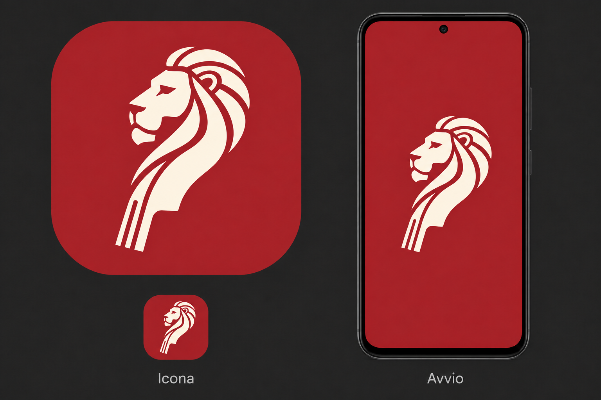

# Icona e avvio — leone/ricciolo

Proposta approvata da Luigi il 7 novembre 2026. Riferimento originale:
https://chatgpt.com/s/m_6aef05068a748191a2a2a4322a97daf4

## Contratto visivo

Leone semplificato rivolto a sinistra, con ricciolo e manico integrati; asse
inclinato di circa 15° dal basso sinistra verso alto destra. Conservare esattamente
il disegno approvato, senza specchiarlo o aggiungere una seconda rotazione.
Simbolo avorio `#FFF5E3`, fondo rosso FFM `#A6282C`, nessuna scritta, ombra o
texture necessaria per riconoscerlo alle dimensioni del launcher.

Il riferimento contiene una simulazione: il master di produzione deve isolare
il simbolo dalla grande icona a sinistra, mantenendo contorni, fori e proporzioni,
con fondo trasparente e tinta uniforme. Conservare il riferimento e la procedura
riproducibile. Il vecchio originale bronzeo resta in `design/lion-logo.jpg`.

## Superfici

Aggiornare insieme icone Android legacy, adaptive e monocromatica, favicon,
icone PWA normali e maskable, icona Apple, logo Informazioni e icone store.
Gli strati adaptive e maskable devono conservare tutto il simbolo nelle rispettive
zone sicure (cerchio centrale 66/108 dp e 80%). Il launcher decide la maschera.

Avvio rosso a schermo intero con simbolo centrale, senza slogan né spinner.
Android 12+ usa il proprio splash di sistema con fondo e simbolo espliciti;
Android precedenti usano un drawable equivalente. Web mostra il simbolo durante
il caricamento e rimuove il caricatore al primo frame Flutter.
Il primo frame Flutter riprende lo stesso rosso e simbolo, poi lo dissolve in
circa 180 ms verso il tema attivo. Nessuna attesa minima, nessun ritardo imposto
ad audio o interazione; con animazioni disabilitate il passaggio è immediato.
Il marchio rimane uguale con entrambe le varianti interne del tema.

## Implementazione e verifica

1. Isolare il master, generare tutte le risoluzioni con `tool/make_icons_test.dart`.
2. Uniformare risorse native e web; distinguere rosso del marchio dal fondo
   antracite dell'app. Evitare flash bianchi o vecchie icone bronzee.
3. Aggiungere la breve dissolvenza Flutter senza cambiare sezione iniziale,
   preferenze, azioni, audio o permessi.
4. Verificare master, trasparenza, maschere circolare/squircle e leggibilità piccola;
   testare dissolvenza, riduzione movimento e assenza di blocco dei tocchi.
5. Eseguire formattazione, analisi, suite e build web/Android in CI.

La verifica automatica non sostituisce la prova di avvio a freddo su Android
prima e dopo API 31 e PWA da Home su iPad, anche offline e con movimento ridotto.
Misurare RNF-AVV-01 sul telefono; nessuna nuova promessa di tempi assoluti.
