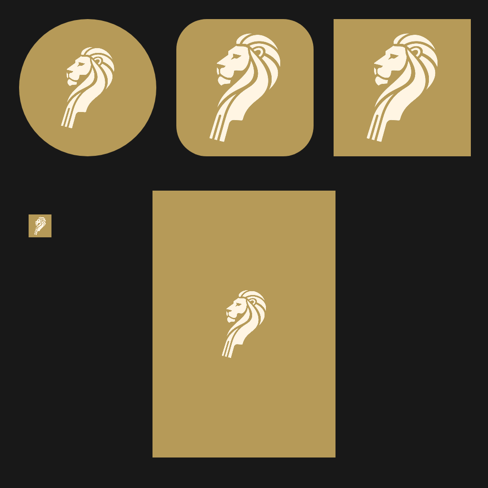

# Icona e avvio — leone/ricciolo

Proposta approvata da Luigi il 7 novembre 2026. Il riferimento visivo originale
è conservato nell’immagine seguente.

## Aggiornamento cromatico corrente

Il [colore d’accento unico](specs/colore-accento.md) sostituisce il rosso fisso
con `LowEndBrand.accent`: ottone `#B69A58` predefinito, `ffmRed` conservato.
Generatore, icone e tutti i livelli dell’avvio seguono questa costante.
Il disegno avorio approvato resta identico. Le indicazioni sul rosso seguenti
descrivono il riferimento originale.

## Contratto visivo

Leone semplificato rivolto a sinistra, con ricciolo e manico integrati; asse
inclinato di circa 15° dal basso sinistra verso alto destra. Conservare esattamente
il disegno approvato, senza specchiarlo o aggiungere una seconda rotazione.
Simbolo avorio `#FFF5E3`, fondo rosso FFM `#A6282C`, nessuna scritta, ombra o
texture necessaria per riconoscerlo alle dimensioni del launcher.

Il riferimento contiene una simulazione: il master di produzione deve isolare
il simbolo dalla grande icona a sinistra, mantenendo contorni, fori e proporzioni,
con fondo trasparente e tinta uniforme. Conservare il riferimento e la procedura
riproducibile. Il vecchio originale bronzeo resta in `design/lion-logo.jpg`.

## Superfici

Aggiornare insieme icone Android legacy, adaptive e monocromatica, favicon,
icone PWA normali e maskable, icona Apple, logo Informazioni e icone store.
Gli strati adaptive e maskable devono conservare tutto il simbolo nelle rispettive
zone sicure (cerchio centrale 66/108 dp e 80%). Il launcher decide la maschera.

Avvio rosso a schermo intero con simbolo centrale, senza slogan né spinner.
Android 12+ usa il proprio splash di sistema con fondo e simbolo espliciti;
Android precedenti usano un drawable equivalente. Web mostra il simbolo durante
il caricamento e rimuove il caricatore al primo frame Flutter.
Il primo frame Flutter riprende lo stesso rosso e simbolo, poi lo dissolve in
circa 180 ms verso il tema attivo. Nessuna attesa minima, nessun ritardo imposto
ad audio o interazione; con animazioni disabilitate il passaggio è immediato.
Il marchio rimane uguale con entrambe le varianti interne del tema.

## Implementazione e verifica

1. Isolare il master, generare tutte le risoluzioni con `tool/make_icons_test.dart`.
2. Uniformare risorse native e web; distinguere rosso del marchio dal fondo
   antracite dell'app. Evitare flash bianchi o vecchie icone bronzee.
3. Aggiungere la breve dissolvenza Flutter senza cambiare sezione iniziale,
   preferenze, azioni, audio o permessi.
4. Verificare master, trasparenza, maschere circolare/squircle e leggibilità piccola;
   testare dissolvenza, riduzione movimento e assenza di blocco dei tocchi.
5. Eseguire formattazione, analisi, suite e build web/Android in CI.

La verifica automatica non sostituisce la prova di avvio a freddo su Android
prima e dopo API 31 e PWA da Home su iPad, anche offline e con movimento ridotto.
Misurare RNF-AVV-01 sul telefono; nessuna nuova promessa di tempi assoluti.

## Realizzazione

Il generatore estrae il simbolo dal riferimento approvato a 1536×1024,
rettangolo `(292,116,350,532)`, ricava la copertura dei bordi dal canale verde
e applica la tinta avorio uniforme. Produce `design/lion-mark.png` e tutte le
risorse; non richiede pacchetti aggiuntivi. L'immagine bronzea è conservata.

Il simbolo adaptive occupa metà dell'altezza dello strato 108 dp: anche gli
estremi del manico inclinato rientrano nel cerchio sicuro da 66 dp. La versione
maskable usa il 60%. Le icone normali usano l'80%.
Per un passaggio coerente da Android 12 al primo frame Flutter, l'avvio usa
un riquadro trasparente da 288 dp con simbolo al 50%: la dimensione è adeguata
allo splash di sistema, più contenuta della simulazione a schermo intero.
Anche il caricatore HTML usa lo stesso riquadro.

`LowEndBrand` centralizza colori, risorsa e durata della transizione.
`StartupReveal` si monta solo in `main`, una volta per processo: costruisce
subito l'app sotto un livello che ignora tocchi e semantica. La dissolvenza
parte dopo il primo frame con l'immagine disponibile; con movimento ridotto
o navigazione accessibile si rimuove subito. Un errore dell'asset non blocca
l'avvio. Nessun timer di attesa e nessun nuovo permesso o azione.

### Verifica del recupero del 7 novembre 2026

- Riferimento e tavola di produzione confrontati con gli allegati approvati.
- Recupero sul `main` aggiornato, conservando le ultime modifiche alla cornice
  rossa, alla navigazione inferiore chiara e ai colori semantici dei temi.
- Formattazione Dart, analisi statica e `git diff --check`: superati.
- Suite completa rieseguita: **875 test superati** in una singola esecuzione,
  inclusi maschere adaptive, startup, movimento ridotto e temi.
- Build web release WASM e fallback JavaScript: superata; cache offline generata.
- Build Android e avvio su dispositivi reali: non eseguiti in questo ambiente;
  da verificare in CI e su telefono/iPad prima del rilascio.
