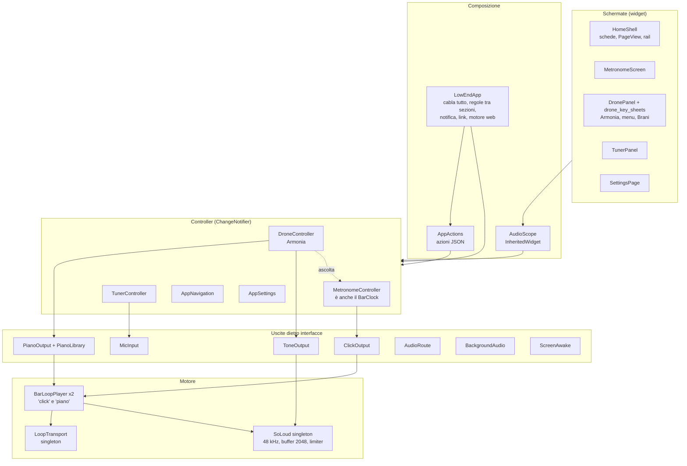
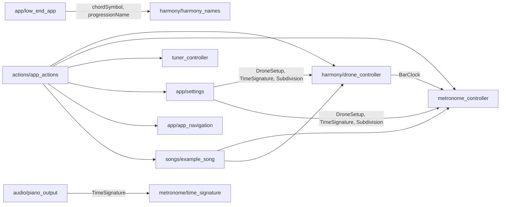
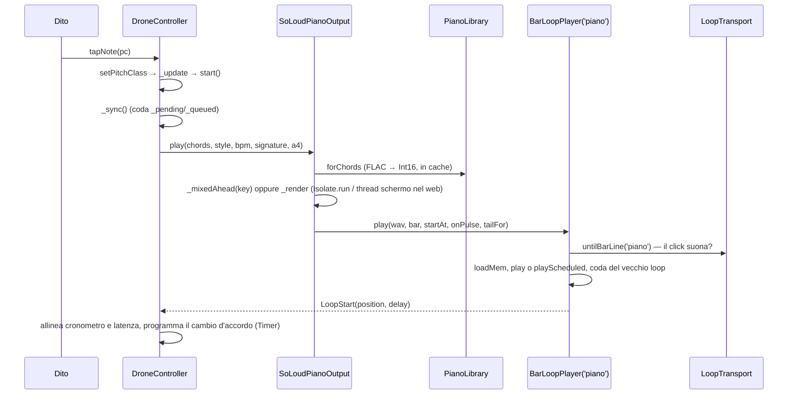

# Architettura di Low End, com'è oggi

Fotografia di `main` al 4 novembre 2026 (PR #97). Completa [docs/architecture.md](../architecture.md), che resta la guida per chi sviluppa: qui l'accento è su **dipendenze, flussi a runtime e thread**, cioè su ciò che serve per valutare l'architettura.

Dimensioni: ~14.600 righe di Dart in `lib/` (esclusi i file generati della traduzione), 39 file di test con ~430 test, 13 MB di campioni (pianoforte 9,4 MB, contrabbasso 3,5 MB), 6 pacchetti di terze parti a runtime (`flutter_soloud`, `record`, `audio_service`, `shared_preferences`, `wakelock_plus`, `url_launcher`, più `intl`).

## 1. Vista d'insieme

Tre livelli come dice `docs/architecture.md` (schermate → controller → uscite), più due pezzi trasversali: **`LowEndApp`**, che crea tutti gli oggetti e applica le regole che legano le sezioni, e **`AppActions`**, la seconda porta d'ingresso ai controller accanto alle dita.

## 2. Moduli e responsabilità

| Modulo | Righe | Responsabilità reali |
| --- | ---: | --- |
| `app/low_end_app.dart` | 468 | Crea i controller e le uscite (o i finti dei test); ripristina impostazioni e Armonia; collega le regole tra sezioni e mostra lo snackbar "Riprendi" solo per le interruzioni (chiamata, browser); testo della notifica multimediale; schermo acceso; link d'azione; avvio anticipato del motore nel web; preparazione del pianoforte al cambio di sezione |
| `app/playback_rules.dart` | 155 | Dal 5/11 (passo 8): `PauseRules` (pausa per accordatore, cuffie staccate e interruzioni web, e ripresa) e `NowPlayingNotification` (stato della notifica, pausa e ripresa dai suoi pulsanti), su due `SoundSection` |
| `app/home_shell.dart` | 390 | Schede in basso o rail a sinistra, `PageView` con le tre sezioni sempre vive (`KeepAlive`, `TickerMode` per quelle fuori schermo), suggerimento di scorrimento |
| `app/settings.dart` | 445 | Tutte le preferenze in `shared_preferences`, una chiave per valore (18 chiavi; l'Armonia in una sola, JSON), lettura tollerante agli errori; memoria del metronomo, della sezione e dell'Armonia |
| `features/metronome/metronome_controller.dart` | 329 | Tempo, metro, suddivisione, TAP; genera la battuta (`ClickSound.bar`) e la manda all'uscita; tiene un cronometro per la luce; fa da `BarClock` per l'Armonia |
| `features/harmony/drone_controller.dart` | 841 | **Armonia**: modello armonico (nota, accordo, giro, gradi, ortografia ♯/♭, note della tonalità), scelta pianoforte o suono tenuto, coda delle modifiche al suono, preparazione e pre-mix del loop, conteggio delle battute del giro, stato d'attesa per l'interfaccia |
| `features/harmony/harmony.dart` | 394 | Dati: qualità d'accordo (rapporti puri e semitoni), giri, sezioni, brani di esempio con JSON |
| `features/songs/example_song.dart` | 30 | `applySong`: applica un brano chiamando uno per uno i setter di Armonia e Metronomo |
| `features/harmony/drone_panel.dart` + `drone_key_sheets.dart` | 961 + 341 | Quadrante delle note, centro con conto alla rovescia e attesa, menu accordo/giro/stile, lista dei brani; anche funzioni di nome (`chordSymbol`, `progressionName`) usate dalla notifica |
| `features/tuner/tuner_controller.dart` | 205 | Microfono, finestra scorrevole, YIN, mediana delle letture, stato e permessi |
| `actions/app_actions.dart` | 852 | Catalogo delle azioni (schema JSON), controllo degli argomenti, esecuzione sui controller, stato completo, parser dei link |
| `audio/piano_output.dart` | 559 | `PianoLibrary` (lettura e decodifica FLAC, cache delle note), `SoLoudPianoOutput` (mix del loop, pre-mix prima del tocco, coda, tempi di conservazione dei campioni) |
| `audio/piano_sound.dart` | 1078 | Il mix: colpi, umanizzazione, arpeggi, comping, walking, smorzatori, normalizzazione; versione a passi (`sync*`) per il web; coda |
| `audio/walking_bass.dart` | 423 | La linea di basso (regole), campioni del contrabbasso |
| `audio/bar_loop_player.dart` | 425 | Carica un WAV nel motore e lo suona in loop; sostituzioni: continua, aspetta la stanghetta dell'altro loop, entra sul battito, dissolvenza, coda |
| `audio/loop_transport.dart` | 153 | Registro dei due loop (uno per l'app, altri nei test): quanto manca alla stanghetta dell'altro, a che punto della battuta è |
| `audio/loop_engine.dart` | 155 | Dal 5/11 (passo 10): le chiamate a SoLoud dei loop dietro un'interfaccia; il motore finto con il suo orologio è in `test/fake_loop_engine.dart` |
| `audio/latest_request.dart`, `sound_clock.dart`, `audio_format.dart`, `sound_section.dart` | piccoli | Dal 5/11 (passi 6–8): l'ultima richiesta una alla volta, quando si sente un loop, frequenza di campionamento e lunghezza della battuta, che cosa suona e si ferma |
| `audio/soloud_engine.dart` | 99 | Avvio unico del motore (48 kHz, buffer 2048, limiter, riscaldamento 300 ms, 100 nel web), latenze d'uscita |
| `audio/click_sound.dart`, `drone_sound.dart`, `freeverb.dart` | 238, 93, 178 | Click sintetico, suono tenuto senza giunture, riverbero |
| `audio/in_steps.dart`, `off_thread.dart` | 62, 10 | Lavoro a fette nel web; `Isolate.run` su Android, `Future` sul thread dello schermo nel web |
| `audio/web_*`, `browser_flac*`, `web/flutter_bootstrap.js`, `tool/web_offline.dart` | ~600 | Web: caricamento del motore dopo il primo frame, sveglia e sonno del contesto audio, sessione audio Safari, decodifica FLAC del browser, service worker con COOP/COEP |

## 3. Dipendenze tra moduli

Da notare (fino al 5/11): il **metronomo dipendeva dall'Armonia** (l'interfaccia `BarClock` stava in `drone_controller.dart`; ora in `metronome/bar_clock.dart`), l'Armonia vive dentro la cartella dell'**accordatore** (`features/tuner/drone/`), le **impostazioni** conoscono i tipi interni di Armonia e Metronomo, e la **notifica** prende i nomi degli accordi da un file di schermata.

## 4. Flussi a runtime

### 4.1 Avvio dell'app

1. `main()` legge le impostazioni (`AppSettings.load`, unico `await` prima di `runApp`), registra le licenze, avvia `LowEndApp`.
2. `LowEndApp.initState` crea i controller (le uscite reali non toccano il motore), ripristina metronomo e Armonia, collega gli ascoltatori.
3. Dopo il primo frame: se si è sull'accordatore parte il microfono; se si è sull'Armonia `preparePiano()` legge i campioni e pre-mixa il loop; nel web, se la pagina è isolata, il motore parte silenzioso dopo 300 ms.

Il motore SoLoud **non** parte all'avvio su Android: parte al primo suono o alla prima preparazione del pianoforte (che su Android chiama `ensureSoLoud`).

### 4.2 Tocco su una nota dell'Armonia (pianoforte)

Il loop è **un'unica registrazione** di tutte le battute (un accordo, o tutto il giro), lunga un numero intero di battute del metronomo. Il cambio d'accordo che si vede sullo schermo è un `Timer` di Dart allineato alla posizione del loop, non un evento del motore.

### 4.3 Modifiche mentre suona

Ogni setter dell'Armonia (`setPitchClass`, `setChord`, `setStyle`, `setProgression`, `setVoicing`, `setContinuous`, `setReferencePitch`) cambia lo stato e chiama `_sync()`. `_sync` mette in fila al massimo **un** lavoro dopo quello in corso, che quando arriva il suo turno legge lo stato di quel momento. Anche un cambio di tempo o metro del metronomo arriva all'Armonia (ascoltatore `_onClockChanged`) e rifà il loop.

Il metronomo ha un meccanismo equivalente scritto in un altro modo (`_syncing`/`_syncAgain`); l'accordatore un terzo (`_generation`).

*Dal 5/11 (passo 6):* metronomo e Armonia usano la stessa `LatestRequest` (un lavoro alla volta, e quello in attesa è sempre l'ultimo) e lo stesso `SoundClock` per la luce; l'accordatore tiene `_generation`.

**Cambio di brano** (`applySong`): oggi chiama cinque setter dell'Armonia e da due a quattro del metronomo. Il primo setter fa già partire un loop (il vecchio giro nella nuova tonalità), poi il resto si accoda: due mix completi, di cui uno mai sentito. Nel web entrambi girano sul thread dello schermo: ~3,8 s di schermo fermo su un S20 FE. La PR #98 aggiunge `applyAll`, che sospende le reazioni dei setter durante il brano e poi riavvia una volta sola, mixando a fette da 50 ms.

### 4.4 Accordatore e regole tra sezioni

`LowEndApp` ascolta i controller e fa rispettare le regole: quando l'accordatore inizia ad ascoltare mentre qualcosa suona, ferma Armonia e Metronomo e mostra lo snackbar "Riprendi"; cambiando sezione accende o spegne il microfono; la stessa funzione `_pauseFor` gestisce cuffie staccate e interruzioni del browser. La notifica multimediale ha una piccola macchina a stati (`_shown`, `_pausedFromNotification`, `_stoppingFromNotification`, `_heldDrone`, `_heldMetronome`).

*Dal 5/11 (passo 8):* queste regole sono in `PauseRules` e `NowPlayingNotification` (`app/playback_rules.dart`); `LowEndApp` le collega ai controller, all'accordatore, alle cuffie e alla notifica, e mostra lo snackbar.

## 5. Modello dei thread

| Lavoro | Android | Web (Chrome/Edge, wasm + Skwasm) | Web (Safari/iPhone, JS + CanvasKit) |
| --- | --- | --- | --- |
| Interfaccia e controller | thread UI | thread della pagina | thread della pagina |
| Disegno | raster thread | worker Skwasm (pagina isolata) | thread della pagina |
| Mix audio | thread di SoLoud (miniaudio/AAudio) | AudioWorklet (pagina isolata) o ScriptProcessor | idem |
| Decodifica FLAC | dal 5/11 nell'isolate del pianoforte (`IsolatePianoMixer`): decoder di miniaudio (un `compute` a file) e conversione a Int16 | decoder del browser (asincrono) | decoder del browser |
| Mix del loop dell'Armonia | dal 5/11 nell'isolate del pianoforte, che resta vivo e tiene i campioni (niente copia; il WAV torna senza copia). I file li legge l'isolate principale e li passa all'isolate del pianoforte (letti da lì, su Android la risposta non arrivava mai: 1.4.0 bloccata su "Preparo i suoni"). Se non parte, fallisce o non risponde alla prima richiesta entro 20 s, `Isolate.run` come prima (`FallingBackMixer`) | thread della pagina, sempre a fette (6 ms prima del tocco, 25 al tocco, 50 per un cambio alla stanghetta) | idem |
| Coda (rilascio delle note) | nell'isolate del pianoforte | thread della pagina, a fette da 50 ms | idem |
| Battuta del metronomo | thread UI (piccola) | thread della pagina | idem |
| Suono tenuto | `Isolate.run` | thread della pagina | idem |
| YIN | thread UI, ogni 50 ms | thread della pagina | idem |

## 6. Dati, cache e memoria

- **Impostazioni**: `shared_preferences`, chiavi singole; dal 5/11 (passo 9) l'Armonia è un solo valore JSON (`harmony`) con le parole dei brani, e le 8 chiavi di prima (`harmony_*`) si leggono una volta, si riscrivono così e si tolgono.
- **Campioni del pianoforte**: 13 note × 3 dinamiche × 2 canali + smorzatori, FLAC 16 bit 48 kHz; decodificati in `Int16List` (~3,5 MB per nota con le tre dinamiche). Ne restano in memoria fino a 8 oltre a quelli che servono. Su Android si liberano 30 s dopo lo stop (2 minuti se solo preparati); nel web restano finché la pagina è aperta.
- **Contrabbasso**: ~90 file letti tutti insieme la prima volta che serve (dal 4/11 solo quando lo stile è walking; prima anche subito dopo il pianoforte con `prefetchBass: true`). Dieci file alla volta con un frame in mezzo, anche su Android, dove la decodifica FLAC e la conversione in Int16 girano sul thread dello schermo. Aprendo sull'Armonia il pianoforte si prepara 1,2 s dopo il primo frame (`LowEndApp.prepareAfterLaunch`).
- **Loop mixati**: buffer `Float64` stereo per tutta la lunghezza del giro, poi riverbero, poi WAV 16 bit; un giro di 12 battute a 80 BPM sono 36 s, cioè ~28 MB per ogni buffer `Float64` stereo (stima, mai misurata).
- **Pre-mix**: uno solo, con una chiave testuale di tutti i parametri; un parametro diverso lo butta.
- **Motore**: due voci in loop al massimo (click e piano) più code e dissolvenze; i sorgenti vecchi si liberano con ritardi a tempo.

## 7. Build, test e distribuzione

- **CI** (`.github/workflows/ci.yml`): formato, `flutter analyze`, `flutter test` su ogni PR.
- **Web** (`web.yml`): `flutter build web --wasm`, generazione del service worker (`tool/web_offline.dart`: cache del nucleo, cache dei suoni, intestazioni COOP/COEP iniettate), pubblicazione su GitHub Pages a ogni push su `main`.
- **Android**: `flutter build appbundle --release` a mano, firmato con la chiave di upload fuori dal repository; caricamento su Play a mano.
- **Strumenti**: `tool/prepare_piano.dart` e `prepare_bass.dart` preparano i campioni; screenshot dello store da `test_screenshots/`.
- **Banco di prestazioni web**: fuori dal repository, in `/mnt/project-files/perf-web/` (Playwright, rete e CPU rallentate).
