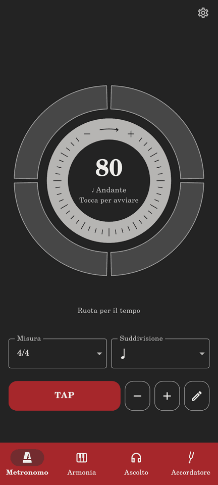

# Ghiera del tempo del metronomo

Proposta approvata da Luigi il 7 novembre 2026. Requisito: **RF-MET-09**.

**Revisione 2 — esterna sottile**, scelta da Luigi dopo la prova sul telefono.
La prima versione interna (PR #138) era visivamente troppo tozza. Questa
revisione sostituisce la posizione e lo spessore della fascia, conservandone
la regolazione relativa e tutte le protezioni dei gesti.

## Problema e scelta

Un musicista trova lenta la regolazione con − e + e propone passi di 5 BPM.
I pulsanti già accelerano durante la pressione lunga, ma il gesto è poco
scopribile. Si aggiunge una ghiera per le variazioni ampie, mantenendo ±1
per rifinire, TAP e inserimento numerico.

La variante scelta è **B · Esterna sottile**: fascia chiara sul bordo esterno,
spessa circa metà della precedente, battiti spostati all'interno e centro
più libero. L'ingombro complessivo del quadrante e le righe dei controlli
restano invariati. La simulazione è un riferimento visivo; la nuova PR deve
includere una schermata renderizzata dal codice.

## Aspetto e comportamento

- Fascia grigio chiaro opaco, tacche scure, centro scuro e BPM leggibili.
  Colori ricavati dal tema anche in Wood & Brass, senza nuove impostazioni.
  Il rosso resta un segnale dei battiti, non la posizione della ghiera.
- La ghiera è l'anello più esterno: tratto visibile fino a **20 dp**, contro
  i precedenti 40 dp, proporzionato nei quadranti piccoli. Lo spazio scuro
  adiacente amplia l'area trascinabile fino a **36 dp** senza invadere i battiti.
- I segmenti dei battiti si spostano verso il centro, conservando spessore,
  colori, accenti e suddivisione della misura. Un intervallo scuro separa
  la loro area dalla zona sensibile della ghiera. Il centro guadagna spazio.
- Geometria specifica del Metronomo: nessuna modifica agli altri quadranti,
  al diametro complessivo o alla posizione delle righe inferiori.
- Rotazione oraria: aumenta; antioraria: diminuisce. **90° valgono 30 BPM**,
  senza accelerazione dipendente dalla velocità. Sensibilità iniziale da
  verificare sul telefono.
- Regolazione relativa: appoggiare il dito non salta a un valore assoluto.
  Si può iniziare ovunque, attraversare ore 12 e compiere più giri.
  Nessuna scala numerica fissa o indicatore di posizione assoluta.
- Appoggiare il dito, un tocco sulla fascia o un movimento trascurabile
  non cambiano BPM o riproduzione. Il gesto resta della ghiera se il dito esce
  dalla fascia; vicino al centro il calcolo angolare si sospende per evitare
  salti. Annullare termina il gesto conservando il tempo già scelto.
- La ghiera prende il gesto prima dello swipe delle sezioni, in entrambi i
  layout. Un secondo dito non modifica il gesto in corso. Fuori dalla fascia
  gli swipe e il tocco sull'anello dei battiti restano disponibili.
- Il centro continua ad avviare e fermare. Il rilascio della ghiera non lo
  attiva. Una breve indicazione localizzata «Ruota per il tempo» occupa la
  riga prima vuota sotto il quadrante; niente testi sovrapposti al numero.
- Limiti esistenti: 30–250 BPM, fino a 400 in 7/8. Nessun avvolgimento massimo
  → minimo. Invertendo al limite il tempo risponde subito, senza dover
  recuperare una rotazione eccedente.
- Come −/+ (**RF-MET-08**), il numero cambia subito; mentre il metronomo suona,
  click e Armonia seguono dopo 300 ms senza variazioni del valore, conservando
  la posizione musicale. Riutilizzare `MetronomeController.step` e il suo
  debounce; nessuna ricostruzione audio per ogni evento del dito.
- Persistenza attraverso il controller esistente; nessun nuovo tempo o
  azione. `metronome_set(bpm: ...)` copre già il risultato del gesto.

## Accessibilità e dimensioni

La ghiera è uno slider distinto dal pulsante centrale: nome e suggerimento
localizzati, valore in BPM, aumenta/diminuisci di 1 solo entro i limiti.
−/+, TAP e matita rimangono alternative senza trascinamento. La fascia visibile arriva
a 20 dp; l'area sensibile è più larga, arriva a 36 dp e si adatta ai quadranti
piccoli senza sovrapporsi ai battiti o al centro. Il centro ridimensiona
il contenuto senza overflow. La leggibilità e l'uso reale con TalkBack e
VoiceOver richiedono una prova sul dispositivo.

## Implementazione e verifica

1. PR documentale: questa proposta, indice delle spec e RF-MET-09.
2. Dal commit documentale, scrivere test di interazione, poi un componente
   locale al metronomo per geometria, pittura e gesto della ghiera.
3. Collegarlo al controller, separando slider e pulsante nelle semantiche
   e nei gesti. Non modificare gli altri quadranti.
4. Aggiungere stringhe IT/EN/ES/FR e aggiornare le due guide utente.
5. Formattare, analizzare, eseguire i test e renderizzare schermate reali.
   Aprire la PR di implementazione collegata alla documentale, dichiarando
   risultati e limiti di verifica.

Le PR sono in sequenza: prima documentazione su `main`, poi implementazione
basata sulla documentale. Non unire automaticamente nessuna delle due.

| Prova | Risultato atteso |
| --- | --- |
| Dito appoggiato, tocco, movimento trascurabile | BPM e riproduzione invariati |
| Quarto di giro nei due sensi | +30 / −30 BPM, salvo i limiti |
| Attraversamento ore 12, più giri, inversione | Nessun salto o avvolgimento |
| Minimo, massimo normale e massimo 7/8 | Limiti rispettati, inversione subito efficace |
| Trascinamento mentre suona | Riproduzione continua, debounce RF-MET-08 |
| Centro, uscita, annullamento, secondo dito | Nessun avvio/stop o salto accidentale |
| Gesto sulla ghiera in entrambi i layout | Nessun cambio di sezione |
| Swipe fuori dalla fascia e blocco gesti | Comportamento precedente conservato |
| Centro, ±1, pressione lunga, TAP, matita | Controlli precedenti funzionanti |
| Lettore di schermo | Slider e pulsante separati, incrementi di 1 |
| Entrambi i temi, piccolo, orizzontale, testo grande | Ghiera visibile, nessun overflow, battiti riconoscibili |

Prima della pubblicazione: provare precisione con un dito, leggibilità dal
leggio, audio con Armonia e accessibilità su Android/iPad.

## Riscontro della prima versione interna (PR #138)

`lib/features/metronome/tempo_dial.dart` contiene la geometria locale,
la fascia chiara con tacche e il riconoscitore che riserva la rotazione
alla ghiera. Il centro e l'anello dei battiti mantengono avvio/stop; lo slider
ha semantiche separate e usa `MetronomeController.step` anche per gli
incrementi accessibili. Non cambia il motore audio né la scelta interna del tema.

Schermata storica della prima versione, **superata dalla revisione 2**
(Anthracite & Red, italiano, metronomo fermo):



Verifica locale: suite completa di **860 test** superata, inclusi 15 casi
dedicati alla ghiera; analisi statica e formattazione pulite. Dieci
configurazioni di revisione visiva (IT/EN, verticale/orizzontale, schermo
piccolo e testo ingrandito) renderizzate con esito positivo:

```sh
flutter test
flutter analyze
dart format --output=none --set-exit-if-changed lib test
flutter build web --wasm --release --no-web-resources-cdn
flutter test test_screenshots/ui_review_test.dart --plain-name 'metronome and settings' --update-goldens
```

Il generatore di schermate ora apre esplicitamente il Metronomo: l'app può
avviarsi su Armonia e non è corretto assumere la sezione iniziale. Le immagini
complete generate per revisione restano fuori dai test di regressione;
quella sopra è il riferimento incluso nella documentazione.

Build web release (WASM e fallback JavaScript) riuscita. La build Android
resta affidata al workflow CI della PR; non è stata eseguita localmente.

RF-MET-09 resta **◐**: ergonomia, sensibilità, lettori di schermo reali e
ascolto sul telefono/iPad sono ancora da provare, non dimostrati dai test.

## Criteri aggiuntivi della revisione 2

- Ghiera visibile dimezzata ed esterna; nessuna seconda ghiera interna.
- Area sensibile più larga del tratto, ma separata da battiti e centro.
- Una rotazione iniziata nel margine scuro della ghiera regola i BPM;
  un tocco sui battiti avvia/ferma e non regola il tempo.
- Stesso ingombro del quadrante; il centro è almeno ampio come prima.
- Verificare almeno 1/1, 4/4 e 6/8 (battito attivo compreso), portrait,
  landscape, schermo piccolo e testo ingrandito.
- Ripetere i test dei gesti e dell'accessibilità della prima versione.
  Sensibilità invariata: 90° = 30 BPM, ±1/TAP/matita e debounce invariati.
