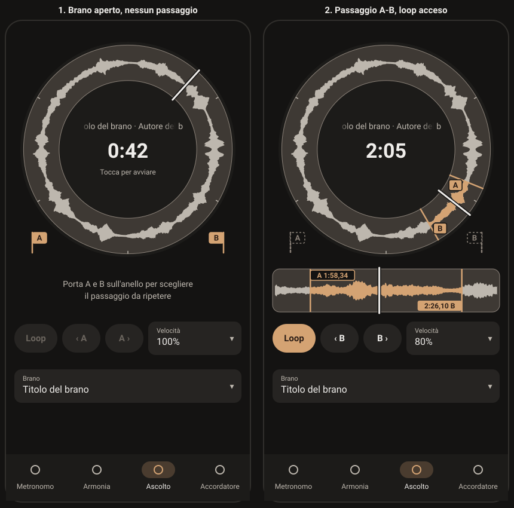

# Player (Ascolto): piano di riferimento

Il terzo tab di Low End: un brano proprio, rallentato senza cambiare intonazione, con un passaggio che si ripete. Questo file dice **come** si costruisce e in quali passi; **cosa** l'app deve fare sta in [requisiti.md](requisiti.md), sezione 2.10 (codici RF-PLY). Se i due file dicono cose diverse vale `requisiti.md`, e questo file va corretto.

Revisione 3, 6 novembre 2026 sera: rivede la scelta del passaggio dopo la seconda prova di Luigi (su `main` fino alla PR #129). Valuta la sua proposta (bandiere A e B, striscia dritta della forma d'onda sotto il quadrante, niente zoom sul toro), dice cosa conviene tenere e come costruirlo. Le revisioni 1 e 2 sono nella storia di git di questo file.

## 1. Come si usa

- **Spec prima del codice.** Una decisione nuova si scrive prima in `requisiti.md`, poi qui, poi nel codice. Ogni PR cita i codici RF-PLY che realizza, nei commit, nella descrizione e nei nomi dei test, e alla fine aggiorna la colonna Stato (◐ unita, ✓ dopo la prova sul telefono).
- **Per chi implementa (una sessione Sonnet che lavora da sola).** Leggi `CLAUDE.md`, `docs/architecture.md`, `docs/specs/README.md`, la sezione 2.10 di `requisiti.md` e questo file. Poi una PR alla volta, nell'ordine della sezione 6, ognuna su un ramo nuovo da `main` aggiornato e solo dopo che la precedente è unita. Ogni PR lascia l'app funzionante e passa format, analyze, test e le build APK e web della CI.
- **Le scelte di prodotto sono già fatte.** Una scelta tecnica non coperta qui: la più semplice che rispetta `CLAUDE.md`, scritta nella PR sotto "Scelte fatte". Fermati solo al CANCELLO 3, dove servono Luigi e il telefono. Le domande della sezione 10 hanno una risposta predefinita: usala senza aspettare.
- **Flutter nel container.** Se manca, scarica `flutter_linux_3.47.9-stable.tar.xz` da `https://storage.googleapis.com/flutter_infra_release/releases/stable/linux/`, scompattalo fuori dal repository e metti `flutter/bin` nel PATH.
- **Da non fare:** spettrogramma, file_picker, just_audio_background, riconoscimento del tempo, registrazione (fase 1b, da approvare a parte), colori o testi scritti nel codice, dipendenze nuove oltre a quelle già in `pubspec.yaml`.

## 2. Dove siamo

In `main` dal 6/11:

| PR | Cosa porta | Codici |
| --- | --- | --- |
| #122, #123 | Il tab, il motore (just_audio 0.10.6), velocità 50-125%, loop A-B, azioni `player_*` | RF-PLY-01…12 |
| #124 | Revisione 2 di questo piano | — |
| #125 | Ordine Metronomo, Armonia, Ascolto, Accordatore; cursore radiale; forma d'onda nel toro (Android e web) | RF-GEN-01, RF-PLY-03, 15 |
| #126 | Passaggio sul toro: pressione lunga per disegnare, maniglie A e B trascinabili, vista Passaggio legata al Loop, riga dei messaggi, gruppi A e B con − e + da 10 ms | RF-PLY-09…12, 16…18 |
| #129 | Brano, passaggio e velocità ricordati; titolo e autore dai tag; cache dei picchi | RF-PLY-13, 14 |

File del Player: `lib/features/player/` (`player_controller.dart`, `player_dial.dart`, `player_panel.dart`, `ring_window.dart`, `ring_wave.dart`, `track_peaks.dart`, `track_tags.dart`, `player_setup.dart`, `clock_text.dart`), `lib/audio/track_output.dart`, `lib/audio/track_files*.dart`, `lib/widgets/step_button.dart`, `android/.../TrackFiles.kt` e `TrackPeaks.kt`, `lowEndPeaks` in `web/flutter_bootstrap.js`.

Le prove del CANCELLO 2 non riportate (velocità al 70 e al 50%, stacco del loop, peso dell'APK, iPhone) passano al CANCELLO 3.

## 3. La proposta di Luigi (6/11 sera): pro e contro



*A sinistra il brano aperto senza passaggio; a destra il passaggio posato, il loop acceso e la bandiera B attiva. Disegno indicativo: nell'app il Loop resta l'icona di oggi e i colori vengono dal tema.*

### 3.1 Cosa non funziona oggi, e perché

| Punto di Luigi | Causa nel codice di oggi | Come lo risolve la revisione 3 |
| --- | --- | --- |
| 1. Non si capisce come uscire dallo zoom | La vista Passaggio è legata al Loop: per uscire bisogna spegnere il Loop, ma niente lo dice | Il toro mostra **sempre** il brano intero; lo zoom è la striscia della prima riga, che c'è quando A e B sono posati. Non c'è più un modo da cui uscire |
| 2. Le selezioni con trascinamento fanno effetto ma non sono chiare | Pressione lunga e scorrere è un gesto invisibile; le maniglie non dicono di essere trascinabili | Le **bandiere** A e B stanno ferme negli angoli, si vedono prima di usarle e si portano sul toro. La pressione lunga sparisce |
| 3. Il Loop è lontano dal cerchio | Sta nella terza riga | Il Loop apre la **seconda** riga, la prima con dei comandi sotto il quadrante |
| 4. Il tempo al centro è grande e non si capisce se debba esserci la fine | "1:12 / 6:03" sotto l'icona play | Al centro **solo il tempo trascorso**, come il numero del metronomo; la durata la dice il lettore di schermo |
| 5. Non si capisce cosa facciano A– e B–; − e + sembrano invertiti; sono nell'ultima riga | "A –" è il segnaposto di un estremo non segnato ma si legge "A meno"; − e + parlano di tempo, ma per A il − allarga il passaggio e per B lo stringe | Due **frecce** ‹ e › che dicono la direzione nel tempo (sinistra prima, destra dopo) con la lettera della bandiera che spostano, nella seconda riga. Niente "A –" |

### 3.2 Pro e contro, punto per punto

| Proposta | Pro | Contro | Raccomandazione |
| --- | --- | --- | --- |
| **Toro con la forma d'onda** (resta) | Piace, funziona, è già fatto | — | Tenere |
| **Niente play al centro, "Tocca per avviare"** | È il modello del metronomo (numero grande e, da fermo, "Tocca per avviare"): tutti i cerchi funzionano allo stesso modo. Libera spazio per titolo e tempo | Fermo o in riproduzione si capisce meno a colpo d'occhio | Sì. Lo stato si vede dal cursore che gira, dal pallino del tab e dalla scritta che c'è solo da fermo; il lettore di schermo continua a dire "Riproduci" o "Pausa" |
| **Titolo e autore che scorrono "come nelle vecchie radio"** | Mostra i tag in uno spazio rotondo e stretto; ha il carattere del quadrante | Un testo che si muove distrae mentre si studia. WCAG 2.2.2 (livello A): un movimento che parte da solo e dura più di 5 s deve potersi fermare | Sì, con misura: scorre **una sola passata** quando si apre il brano e a ogni play, al massimo 5 s, poi resta fermo all'inizio. Fermo se entra, mai con le animazioni ridotte. Solo se il file ha almeno un tag |
| **Tempo più grande, fine sì o no** | Un numero solo si legge da lontano, sul leggio | Senza la durata non si sa quanto manca | Solo il trascorso. La durata è il giro intero del toro (ore 12 è inizio e fine) e la dice il lettore di schermo |
| **Bandiere A e B negli angoli bassi, da trascinare o da toccare e poi toccare il toro** | Si vedono prima di usarle: nessun gesto nascosto. Due passi chiari. Il "tocca e poi tocca" è anche la strada senza trascinare (WCAG 2.5.7, RF-PLY-16). Usano lo spazio vuoto degli angoli. A a sinistra e B a destra si leggono come inizio e fine | Sul toro intero la posa è grossolana: in un brano di 6 minuti un punto vale circa 0,4 s, e il dito copre il punto. Sui quadranti sotto i 280 dp gli angoli sono stretti. Un trascinamento che parte dall'angolo deve vincere sullo scorrimento tra i tab | Sì. Mentre si porta la bandiera il centro mostra il suo tempo al centesimo; la precisione arriva dalla striscia e dalle frecce. Sotto i 280 dp la bandiera tocca il bordo del toro (sezione 5.2). Il trascinamento usa il riconoscitore "vince subito" di oggi |
| **Striscia dritta nella prima riga, centrata sul passaggio** | Niente zoom da cui uscire. È la vista dei programmi audio. Si vedono insieme il brano intero (toro) e il dettaglio (striscia). Forma d'onda più alta (circa 40 dp contro i 25 del toro). Riusa `RingWindow.passage` e `TrackPeaks.heights` | La striscia è lunga circa 350 dp, la vista Passaggio sul toro circa 960: per punto è precisa meno della metà. La prima riga non ha più spazio per i messaggi quando c'è il passaggio. Un trascinamento orizzontale sulla striscia somiglia allo scorrimento tra i tab. È una forma d'onda, non uno spettrogramma (deciso il 6/11) | Sì. Le frecce da 10 ms coprono la precisione che manca. I messaggi servono solo prima del passaggio. Sulla striscia vince subito solo un trascinamento che parte da una bandiera, come sul toro |
| **Seconda riga: Loop, ‹, ›, Velocità** | Loop e ritocchi vicino al cerchio; le frecce dicono la direzione; la Velocità, che si cambia spesso studiando, sale | Con la lettura alla lettera (‹ anticipa A, › posticipa B) le frecce **allargano soltanto**. Il ritocco più comune è stringere: B che prende l'attacco della nota dopo, A che prende la coda di quella prima. Stringere resterebbe affidato al trascinamento sulla striscia, che arriva a circa 30-120 ms, e la precisione da 10 ms chiesta stamattina varrebbe solo in un verso | Sì, con le frecce sulla **bandiera attiva** (sezione 3.3): ‹ e › spostano prima o dopo l'ultima bandiera posata, trascinata o toccata, e portano scritta la sua lettera ("‹ B", "B ›") |
| **Loop dentro il cerchio vicino al play** (prima idea del punto 3) | Vicinissimo | Due bersagli nel centro, dove ogni altro tab ne ha uno; facile toccare quello sbagliato | No: nella seconda riga, come dice la sintesi di Luigi |
| **Terza riga: solo il file** | Si sceglie una volta e via; libera la seconda riga | L'ultima riga è la più comoda per il pollice e va a un comando raro (poco male) | Sì. Senza brano il centro continua ad aprire il selettore |

### 3.3 Le frecce: tre varianti

| Variante | Come funziona | Pro | Contro |
| --- | --- | --- | --- |
| V1, alla lettera | ‹ porta A prima, › porta B dopo | Due pulsanti che fanno sempre la stessa cosa | Allarga e basta: per stringere bisogna trascinare o riposare la bandiera |
| **V2, bandiera attiva (consigliata)** | ‹ e › spostano la bandiera attiva prima o dopo. Attiva è l'ultima posata, trascinata o toccata sulla striscia; le frecce ne portano la lettera e sulla striscia è piena, l'altra vuota | Due pulsanti, tutte e due le direzioni, 10 ms per entrambe le bandiere. Il flusso naturale (posi A e ritocchi A, posi B e ritocchi B) non chiede passi in più | Per tornare ad A dopo aver posato B serve un tocco sulla sua bandierina nella striscia |
| V3, quattro frecce | "‹A", "A›", Loop, "‹B", "B›"; la Velocità scende accanto al file | Nessuna bandiera attiva | Quattro pulsanti dove Luigi ne vuole due; è la riga di oggi con le frecce al posto di − e + |

### 3.4 Cosa resta e cosa sparisce

Restano: motore e regole tra le sezioni, notifica, velocità e il suo foglio, forma d'onda e cache dei picchi, ricordo del brano, la regola "il suono segue dopo 0,3 s di quiete", passi da 10 e 100 ms, "Segna qui" per il lettore di schermo e per gli assistenti, le azioni.

Spariscono: la vista Passaggio sul toro (finestra animata, cucitura a ore 12), la pressione lunga che disegna, la terza riga A / Loop / B con i tempi e i − e +, i suggerimenti "Tieni premuto…" e "Trascina A e B…", l'icona play e la durata al centro.

## 4. Requisiti in breve

Il testo che vale è in `requisiti.md`; qui solo dove si realizzano.

| Codice | In breve | PR |
| --- | --- | --- |
| RF-PLY-02 | Centro come gli altri cerchi: niente icona, tempo trascorso, "Tocca per avviare" da fermo | 6 |
| RF-PLY-03 | Il toro mostra sempre il brano intero; al centro solo il tempo trascorso | 6, 7 |
| RF-PLY-19 | Titolo e autore che scorrono al centro, una passata di al massimo 5 s | 6 |
| RF-PLY-09 | "Segna qui" (meno 150 ms × velocità) con le regole delle bandiere | 7 |
| RF-PLY-10 | Frecce ‹ e › sulla bandiera attiva, 10 ms al tocco, 100 ms tenute | 7 |
| RF-PLY-11 | Bandiere A e B negli angoli: trascinarle sul toro, o toccarle e poi toccare il toro | 7 |
| RF-PLY-12 | Loop primo della seconda riga; il toro non cambia vista | 7 |
| RF-PLY-17 | Striscia del passaggio nella prima riga | 7 |
| RF-PLY-18 | Riga dei messaggi finché le bandiere non sono posate | 7 |
| RF-PLY-16 | Accessibilità: due tocchi, frecce, cursori sulla striscia | 7 |
| RF-PLY-01, 08 | Brano da solo nella terza riga; Velocità nella seconda | 7 |

## 5. Progetto

### 5.1 La schermata

`PlayerPanel` resta un `DialLayout`: il quadrante e tre righe da 80 dp. Larghezza minima da reggere 288 dp (telefono da 320), testo fino a 2×, quattro lingue, verticale e orizzontale (`layout_review_test` e `row_heights_test` girano già su ogni `AppSection`).

| Posto | Senza brano | Brano aperto, bandiere non posate | Bandiere posate |
| --- | --- | --- | --- |
| Toro | Anello spento | Brano intero: forma d'onda, tacche, cursore | In più le bandiere A e B sul toro e, a loop acceso, il passaggio nel colore d'accento |
| Centro | Cartella e "Scegli un brano" (apre il selettore) | Titolo e autore (se ci sono tag), tempo trascorso, "Tocca per avviare" da fermo | Uguale |
| Angoli bassi | Niente | Bandiere A e B piene, pronte | Al loro posto la traccia tratteggiata |
| Prima riga (`header`) | Vuota, o l'errore | Il passo successivo (sezione 5.4) | La striscia del passaggio |
| Seconda riga (`upper`) | Loop, ‹, ›, Velocità spenti | Uguale; le frecce si accendono con la bandiera attiva posata | Accese |
| Terza riga (`lower`) | Brano ("Scegli un brano") | Brano (titolo) | Uguale |

`PlayerPanel` diventa uno `StatefulWidget`: il `Ticker` che oggi sta nel quadrante (e il `ValueNotifier` della posizione letta a ogni frame) sale nel pannello, perché lo usano il quadrante e la striscia. Corre solo mentre il brano suona, come oggi.

### 5.2 Le bandiere

**Una sola forma, tre posti.** Una bandiera è un'asta e una bandierina rettangolare (angoli di 3 dp) con la lettera in `labelLarge` grassetto. La bandierina di A sta a destra dell'asta e quella di B a sinistra, cioè tutte e due verso il passaggio. Un solo painter condiviso, per esempio `paintFlag(canvas, pole, letter, side, look)` in un file nuovo `lib/features/player/flag_painter.dart`, disegna:

| Aspetto | Quando | Colori |
| --- | --- | --- |
| Piena | Nell'angolo, pronta; sul toro; sulla striscia quando è la bandiera attiva | Asta e bandierina `primary`, lettera `onPrimary` |
| Vuota | Sulla striscia quando non è attiva | Bandierina `surface` con bordo `primary` da 1,5 dp, lettera `primary` |
| Traccia | Nell'angolo quando la bandiera è sul toro; sul toro, l'altra bandiera che sta per tornare nel suo angolo (sotto) | Tratteggio 3/3 da 1,5 dp, lettera `onSurfaceVariant`. Il tratteggio deve passare 3:1 sullo sfondo (WCAG 1.4.11): se `outline` non basta, `onSurfaceVariant` |
| Armata | Toccata nell'angolo, in attesa del tocco sul toro | Piena, con un alone: cerchio di 26 dp di raggio, tratto 2 dp, `primary` |

**Negli angoli.** Bersaglio da 48 dp con il centro sulle diagonali basse del quadrante (A a sinistra, B a destra), a distanza `(r − 24) × √2` dal centro (`r` = metà del lato), cioè con il bersaglio che tocca i lati del riquadro. Una funzione pubblica `holderCenter(LoopEdge, Size)` lo dice ai test. Su un quadrante da 380 dp (S20 FE in verticale) resta un margine di circa 25 dp dal bordo esterno del toro. Sotto i 280 dp (telefoni piccoli, schermo diviso) il bersaglio entra nel toro: un tocco entro `ringOuter` va al toro, il resto alla bandiera. Il disegno è alto circa 34 dp (asta) per 24 (bandierina). Le bandiere stanno **dentro** il riquadro del quadrante: in Flutter un figlio dipinto fuori dal genitore non riceve i tocchi.

**Sul toro.** L'asta attraversa il toro come la linea delle maniglie di oggi (2,5 dp, `primary`). La bandierina (circa 0,4 w × 0,3 w, `w` = spessore del toro) ha il centro a 0,25 w per A e a 0,75 w per B, come i dischi di oggi, spostato lungo il giro di mezza larghezza verso il passaggio. La lettera resta dritta. Bersaglio: entro 24 dp dal centro della bandierina o dall'asta (`gripAt` di oggi, con `gripCenter` che diventa il centro della bandierina).

**Portare una bandiera sul toro, trascinando.** Il trascinamento parte entro il bersaglio della bandiera, nell'angolo o sul toro, e vince subito sullo scorrimento tra i tab (sezione 5.8).
- Dall'angolo: la bandiera segue il dito. Quando il dito è nella fascia del toro (dal raggio del centro fino a `ringOuter` + 24 dp) la bandiera si aggancia al toro all'angolo del dito, e il centro del quadrante mostra il suo tempo al centesimo ("A 1:12,34"). Fuori dalla fascia la bandiera si disegna 40 dp sopra il dito, così il dito non la copre. Se la posizione supera l'altra bandiera (A oltre B − 1 s, o B prima di A + 1 s), l'altra si disegna come traccia: lasciando il dito, torna nel suo angolo. Il dito lasciato nella fascia posa la bandiera (`place`, sezione 5.7); lasciato fuori non cambia niente e la bandiera torna nell'angolo.
- Dal toro (bandiera già posata): si sposta seguendo l'angolo del dito con `moveEdge`, che la ferma a 1 s dall'altra e ai bordi del brano, come le maniglie di oggi. Il centro mostra il suo tempo. Il dito non fa il giro oltre ore 12: un salto di più di mezzo giro si ferma all'inizio o alla fine del brano.
- Un tick aptico (`HapticFeedback.selectionClick`) quando la bandiera si stacca dall'angolo o dal toro, e uno quando si aggancia al toro.

**Portare una bandiera sul toro, con due tocchi.** Un tocco sulla bandiera nell'angolo la arma (alone) e la prima riga dice dove toccare. Il tocco seguente sul toro (fuori dal centro) la posa lì con `place`. Un altro tocco sulla stessa bandiera la disarma; un tocco sull'altra arma quella. Mentre una bandiera è armata il tocco sul toro posa e non sposta l'ascolto; il centro continua a fare play e pausa. Si disarma anche cambiando brano o tab.

**Regole della posa** (`place`, uguali per trascinamento, due tocchi e "Segna qui"):
1. La bandiera va al tempo indicato, dentro il brano.
2. Se l'altra è posata e l'ordine non regge più (A oltre B − 1 s, o B prima di A + 1 s), l'altra torna nel suo angolo e il loop si spegne.
3. Se dopo la posa ci sono tutte e due, il loop si accende; se il brano suona, riparte da A (come `setLoop` oggi).
4. La bandiera posata diventa quella attiva.

Non c'è un modo di togliere il passaggio: basta spegnere il Loop, e un brano nuovo riporta le bandiere negli angoli (domanda 5 della sezione 10).

### 5.3 Il toro

Sempre il brano intero: `RingWindow.whole(durata)`. Dal quadrante si tolgono la vista Passaggio (`_morph`, `_from`, `_to`, `_curve`, `_passageView`, `_quiet`, `_retarget`, `_go`), la cucitura (`_RingPainter.seam`, `RingWave.gap`, `_seamGap`), `PlayerDial.passageStep` e la pressione lunga che disegna (`_drawing`, `_drawStart`, `_drawMove`, `_drawEnd`).

| Strato | Cambia? |
| --- | --- |
| Base, tacche (sempre quelle del brano intero) | No |
| Forma d'onda, `primary` dentro il passaggio a loop acceso | No |
| Maniglie | Diventano le bandiere della sezione 5.2 (`_GripsPainter` → painter delle bandiere, che disegna anche gli angoli e la bandiera sotto il dito) |
| Cursore | No |

Gesti sul toro, alla fine:

| Gesto | Effetto |
| --- | --- |
| Tocco (nessuna bandiera armata) | Sposta l'ascolto; a loop acceso, fuori da A-B spegne il loop (regola di oggi) |
| Tocco (bandiera armata) | Posa la bandiera lì |
| Trascinare da una bandiera (angolo o toro) | Sezione 5.2 |
| Scorrere altrove | Cambia sezione |
| Pressione lunga | Niente (tolta) |

### 5.4 La prima riga: messaggi, poi la striscia

Finché le due bandiere non sono posate, la prima riga è quella dei messaggi di oggi (un testo centrato, al massimo due righe, `bodyMedium` in `onSurfaceVariant`; un errore in `colorScheme.error` e in `Semantics(liveRegion: true)`). Il testo dice il passo successivo:

| Stato | Testo (it) |
| --- | --- |
| Errore del file | "Questo file non si può aprire." / "Il file non è più disponibile." |
| Nessuna bandiera posata | "Porta A e B sull'anello per scegliere il passaggio da ripetere" |
| A armata | "Tocca l'anello dove inizia il passaggio" |
| B armata | "Tocca l'anello dove finisce il passaggio" |
| Solo A posata | "Ora porta B dove finisce il passaggio" |
| Solo B posata | "Ora porta A dove inizia il passaggio" |

Con le due bandiere posate la riga diventa la **striscia del passaggio** (file nuovo `lib/features/player/passage_strip.dart`). Il passaggio fra testo e striscia è un `AnimatedSwitcher` in dissolvenza (`Durations.medium2`, `Easing.standard`; niente con le animazioni ridotte).

**Misure.** Tutta la larghezza della riga, alta 72 dp (con testo grande: `max(72, 2 × altezza della bandierina + 36)`), angoli come i campi. Dentro, 12 dp di margine a destra e a sinistra, così un'asta in cima o in fondo al brano resta afferrabile. Tre fasce: in alto la bandierina di A ("A 1:12,34", `labelMedium` grassetto), in basso quella di B ("1:31,00 B"), in mezzo la forma d'onda. Le due bandierine non possono sovrapporsi nemmeno con un passaggio di 1 s.

**Strati**, tutti in un `CustomPainter` dentro un `RepaintBoundary`, più il cursore in un secondo painter mosso dal `Ticker`:

| Strato | Disegno | Colore |
| --- | --- | --- |
| Fondo | Rettangolo arrotondato, bordo 1 dp | `outlineVariant`, bordo `outline` (come il toro) |
| Tacche | In alto, alte 6 dp, ogni `tickInterval(finestra)`, sui multipli veri del brano (`tickTimes`) | `onSurfaceVariant` |
| Forma d'onda | Simmetrica attorno al centro della fascia di mezzo; picchi da `TrackPeaks.heights(from, to, count)` con `count` = un valore ogni 2 dp, mai più dei fotogrammi da 10 ms della finestra | `onSurfaceVariant`; dentro A-B `primary` a loop acceso |
| Aste A e B | Verticali, tutta l'altezza, 2,5 dp | `primary` |
| Bandierine | Piena per la bandiera attiva, vuota per l'altra (sezione 5.2) | — |
| Cursore | Verticale, sporge di 2 dp sopra e sotto: 3 dp sopra 6 dp, solo se è dentro la finestra | `onSurface` sopra `surface` |

**Finestra.** `RingWindow.passage(A, B, durata)` di oggi: il passaggio più un quarto della sua lunghezza per parte (tra 0,5 e 10 s), senza uscire dal brano. In `RingWindow` si aggiungono `fractionOf(Duration)` (0..1, fuori si ferma ai bordi) e `timeAtFraction(double)`; `angleOf` diventa `fractionOf × 2π`. Mentre un'asta è afferrata, o le frecce lavorano, la finestra sta ferma; si riadatta quando A e B restano fermi per `PlayerController.settleAfter` (0,3 s), in `Durations.short4` con `Easing.standard` (`RingWindow.lerp` resta per questo), subito con le animazioni ridotte. È la logica di `_retarget` di oggi, spostata dal quadrante alla striscia.

**Gesti.**

| Gesto | Dove parte | Effetto |
| --- | --- | --- |
| Trascinare | Entro 24 dp in orizzontale da un'asta, o sulla sua bandierina | Sposta quella bandiera con `moveEdge` (si ferma a 1 s dall'altra, ai bordi del brano e della finestra mostrata) e la rende attiva. Vince subito sullo scorrimento tra i tab (sezione 5.8) |
| Tocco | Su una bandierina | La rende attiva (`focus`) |
| Tocco | Altrove | Sposta l'ascolto lì; a loop acceso, fuori da A-B spegne il loop |
| Scorrere | Fuori dalle aste | Cambia sezione |

Con 10 ms per picco, un passaggio di 1 s con i suoi margini (2 s) dà circa 200 valori su 350 dp: barre larghe circa 2 dp, che si vedono ma bastano.

### 5.5 La seconda riga: Loop, frecce, Velocità

`Row` con, nell'ordine e separati da `rowGap`: il Loop, ‹, ›, `Expanded(Velocità)`.

- **Loop**: il `RowButton` di oggi (icone `repeat` / `repeat_on`, pieno mentre ripete, `Semantics(toggled:)`, almeno 48 dp). Spento senza le due bandiere.
- **‹ e ›**: due `StepButton`. Lo `StepButton` riceve un `label` opzionale (un widget) al posto dell'icona; il metronomo non cambia. Le etichette sono `Icons.chevron_left` seguita dalla lettera della bandiera attiva ("‹ A") e la lettera seguita da `Icons.chevron_right` ("A ›"), lettera in `labelLarge`. Un tocco sposta la bandiera attiva di `fineStep` (10 ms); tenuto si ripete accelerando e dopo 2,4 s va di `coarseStep` (100 ms), come oggi. Spente se la bandiera attiva non è posata. Nomi per il lettore di schermo: "Inizio prima" / "Inizio dopo" con A attiva, "Fine prima" / "Fine dopo" con B (chiavi di oggi).
- **Velocità**: il `LabeledField` di oggi con il suo foglio.

Misure a 288 dp: 48 + 56 + 56 + 3 × 8 = 184 dp, ne restano 104 per la Velocità.

La **terza riga** è il solo `LabeledField` Brano, largo quanto la riga, che apre il selettore come oggi.

### 5.6 Il centro del quadrante

| Stato | Contenuto |
| --- | --- |
| Senza brano | Come oggi: cartella e "Scegli un brano"; il tocco apre il selettore |
| In apertura | Come oggi: la rotella |
| Pronto | Dall'alto: titolo e autore (solo se il file ha almeno un tag), il tempo trascorso, e da fermo "Tocca per avviare" |
| Una bandiera trascinata | Al posto del tempo trascorso quello della bandiera, al centesimo ("A 1:12,34"), in `headlineSmall`; torna quando il dito si alza |

- **Niente icona play/pausa.** Il nome per il lettore di schermo resta "Riproduci" o "Pausa".
- **Tempo trascorso**: `displaySmall` grassetto, `onSurface`, cifre tabulari (`FontFeature.tabularFigures()`), così non balla. Un gradino sotto il numero del metronomo (`displayMedium`). Senza la durata. Cambia una volta al secondo, come oggi.
- **"Tocca per avviare"**: `bodySmall` in `onSurfaceVariant`, solo da fermo, come `metronomeHint`.
- **Titolo e autore** (RF-PLY-19), widget nuovo `lib/features/player/marquee.dart`:
  - Testo: titolo e autore separati da " · " (`PlayerController.hasTags` nuovo: vero se il file ha dato un titolo o un autore; senza titolo nei tag vale il nome del file). Una riga, `bodyMedium`, `onSurfaceVariant`, larga l'80% del diametro del centro.
  - Se entra: fermo e centrato.
  - Se non entra: parte 1 s dopo l'apertura del brano (o l'arrivo dei tag) e dopo ogni play; scorre verso sinistra a velocità costante finché si vede la fine (velocità: `max(30 dp/s, eccedenza / 3 s)`), resta 1 s, poi sparisce e ricompare fermo all'inizio (`Durations.medium2` per parte, `Easing.standard`). In tutto non più di 5 s (WCAG 2.2.2). Da fermo, i bordi sfumano con una `ShaderMask` (una maschera alfa: il suo colore non si vede).
  - Con le animazioni ridotte non scorre mai: fermo, con i puntini in fondo.
  - Un `AnimationController` solo durante la passata, in un `RepaintBoundary`; `ExcludeSemantics` (il titolo lo dice già il campo Brano).

### 5.7 Il controller

Modifiche a `PlayerController`:

| Prima | Dopo | PR |
| --- | --- | --- |
| — | `bool get hasTags`: il file ha dato un titolo o un autore | 6 |
| — | `void place(LoopEdge edge, Duration at)`: le regole della sezione 5.2. Con le due bandiere fa quello che fa `setLoop` | 7 |
| — | `LoopEdge get activeEdge`: la bandiera che le frecce spostano. La cambiano `place`, `mark`, `moveEdge` e il nuovo `focus(LoopEdge)`; `setLoop` la mette su B. All'inizio e con un brano nuovo è A. Non si salva | 7 |
| — | `LoopEdge? get armed`, `arm(LoopEdge)` (di nuovo sulla stessa: disarma), `disarm()`. `place`, `open`, `restore` e il cambio di tab (dal pannello) disarmano | 7 |
| `mark(edge)`: A oltre B − 1 s toglie B; B prima di A + 1 s si ferma a A + 1 s; B senza A mette A a 0 e accende il loop | `mark(edge)` = `place(edge, punto ascoltato − 150 ms × velocità)`: stesse regole delle bandiere. B senza A resta da sola | 7 |
| `nudge(edge, by)` | Uguale; le frecce la chiamano con `activeEdge` | 7 |
| `moveEdge`, `setLoop`, `setLooping`, `seek` | Uguali | — |

`activeEdge` e `armed` stanno nel controller, anche se riguardano solo lo schermo, perché li leggono quadrante, prima riga, seconda riga e striscia, che ascoltano già il controller. `PlayerSetup` non cambia: salva già A e B separati, anche uno solo.

### 5.8 I trascinamenti e lo scorrimento tra i tab

Tre posti dove un trascinamento deve vincere subito sul `PageView`: le bandiere negli angoli, le bandiere sul toro, le aste della striscia. Tutti usano il riconoscitore di oggi, che si dichiara vincitore già al tocco ma solo sul suo bersaglio; altrove non partecipa e tocco e scorrimento funzionano come prima (verificato sui sorgenti di Flutter 3.47.9: `isPointerAllowed`, `resolvePointer` e il vincitore anticipato dell'arena).

```dart
/// Un trascinamento che vince subito, prima dello scorrimento tra le
/// sezioni, quando il dito si posa su una bandiera (RF-PLY-11, RF-PLY-17);
/// altrove non partecipa.
class FlagDrag extends PanGestureRecognizer {
  FlagDrag({required this.flagAt});

  /// La bandiera sotto [local] (coordinate del widget), o null.
  final LoopEdge? Function(Offset local) flagAt;

  @override
  bool isPointerAllowed(PointerEvent event) =>
      flagAt(event.localPosition) != null && super.isPointerAllowed(event);

  @override
  void addAllowedPointer(PointerDownEvent event) {
    super.addAllowedPointer(event);
    resolvePointer(event.pointer, GestureDisposition.accepted);
  }
}
```

È `_GripDrag` di `player_dial.dart`, reso pubblico in un file suo (`lib/features/player/flag_drag.dart`) per usarlo anche nella striscia. Nel quadrante resta un solo `RawGestureDetector` grande quanto il riquadro: `flagAt` riconosce sia gli angoli sia le bandiere sul toro, e `onStart` si ricorda da dove è partito il dito. I tocchi sugli angoli (armare) passano dal `GestureDetector` di oggi, che guarda prima se il tocco cade su un angolo. L'impostazione "Blocca i gesti" continua a fermare solo lo scorrimento tra i tab.

### 5.9 Accessibilità (RF-PLY-16)

- **Toro**: resta uno slider ("1:12 di 6:03"), aumenta e diminuisci di 10 s (sempre: non c'è più la vista Passaggio). Le azioni "Segna l'inizio qui" e "Segna la fine qui" restano.
- **Bandiere negli angoli**: due nodi `Semantics` posizionati sui bersagli, pulsanti, con nome "Bandiera A, inizio del passaggio" / "Bandiera B, fine del passaggio". Il doppio tocco del lettore di schermo chiama `mark` (segna dove si ascolta), con `onTapHint` "Segna l'inizio qui" / "Segna la fine qui": per chi non vede, toccare l'anello in un punto preciso non è una strada. I nodi non hanno gesti propri: il dito passa al quadrante.
- **Striscia**: due slider, "Inizio 1:12,34" e "Fine 1:31,00" (chiavi `playerStartAt` / `playerEndAt`), aumenta e diminuisci di 100 ms (`coarseStep`); i 10 ms restano alle frecce. Il disegno è `ExcludeSemantics`.
- **Frecce**: nomi secondo la bandiera attiva (sezione 5.5).
- **Senza trascinare**: le bandiere si posano con due tocchi e si ritoccano con le frecce (WCAG 2.5.7, oltre la 2.1 AA che seguiamo, ma costa poco).
- **Bersagli** da 48 dp; il colore non è l'unico segno: lettere, bandiere piene o vuote, l'icona del Loop.
- **Movimento**: la scritta che scorre rispetta la 2.2.2 (sezione 5.6).

### 5.10 Azioni per assistenti

Nessuna azione nuova né tolta. Cambia la descrizione di `player_mark` (PR 7): "Marks the start or the end of the loop at the point being heard, like the screen reader actions Mark the start here and Mark the end here (on the ring and on the flags); a reaction time of 150 ms times the speed is taken off. A point marked past the other one clears the other. Once both are marked the loop turns on and plays from the start. Fails if no track is open." Poi si rigenera `docs/llm-actions.json` e si allinea `docs/llm.md`.

### 5.11 La forma d'onda

Già in `main` (PR #125 e #129): `TrackPeaks`, `TrackFiles.peaks`, `TrackPeaks.kt` con la cache, `lowEndPeaks` sul web, i limiti di 15 minuti e 40 MB. Non cambia nulla: la striscia legge gli stessi picchi con `heights`.

## 6. Passi

### PR 6: il centro del quadrante

Codici: RF-PLY-02, RF-PLY-03 (solo il centro), RF-PLY-19. Piccola e indipendente: Luigi la vede subito.

1. `PlayerController.hasTags`.
2. `_Hub` di `player_dial.dart`: niente icona, tempo trascorso senza durata, "Tocca per avviare" da fermo, tempo della bandiera trascinata (sezione 5.6).
3. `marquee.dart`, con il suo test.
4. Testi: `playerHubHint` (sezione 7).
5. Test (sezione 8), `requisiti.md` (Stato).

### PR 7: bandiere, striscia e righe

Codici: RF-PLY-01, 08, 09, 10, 11, 12, 16, 17, 18.

1. **Controller**: `place`, `activeEdge`, `focus`, `armed`, `arm`, `disarm`, `mark` attraverso `place` (sezione 5.7).
2. **Toro**: via la vista Passaggio, la cucitura e la pressione lunga (sezione 5.3).
3. **Bandiere**: `flag_painter.dart`, `flag_drag.dart`, angoli, trascinamento, due tocchi, `holderCenter` (sezioni 5.2 e 5.8).
4. **Righe**: prima riga con i messaggi nuovi, seconda con Loop, frecce e Velocità, terza con il solo Brano; `StepButton.label`; `Ticker` e posizione nel pannello (sezioni 5.1, 5.4, 5.5).
5. **Striscia**: `passage_strip.dart`, `RingWindow.fractionOf` e `timeAtFraction` (sezione 5.4).
6. **Accessibilità** (sezione 5.9).
7. **Testi e azioni**: chiavi della sezione 7; descrizione di `player_mark`; golden; `docs/llm.md`; guide utente (`docs/user-guide.md` e `docs/manuale-utente.md`, il paragrafo "Loop per studiare un passaggio"); `guidePlayerLoop`.
8. **Test** (sezione 8) e `requisiti.md`.

Se la PR supera circa 1.500 righe cambiate, dividila: **7a** passi 1-4 e 6-7 senza la striscia (la prima riga resta dei messaggi anche a bandiere posate, con il testo "Ritocca con ‹ e ›"); **7b** la striscia. Dopo la 7a l'app funziona già con bandiere e frecce.

### CANCELLO 3: prova di Luigi sul telefono e sull'iPhone

Sonnet si ferma qui e chiede a Luigi questa prova (circa 20 minuti). I risultati vanno nella colonna Stato di `requisiti.md`.

- Posare A e B: si capisce senza leggere? Meglio trascinare o due tocchi? Gli angoli sono comodi in verticale e in orizzontale?
- La striscia: si legge? Trascinare le aste è comodo? Le frecce sulla bandiera attiva si capiscono, o meglio la variante V1 o V3 (sezione 3.3)?
- Il centro: il tempo ha la misura giusta? La scritta che scorre piace o distrae?
- La forma d'onda corrisponde al suono? Prova: metti A sulla striscia esattamente su un attacco netto e ascolta il giro. Se A cade sempre un po' prima o dopo, si misura lo scarto (sugli MP3 può arrivare a circa 50 ms, il ritardo dell'encoder) e si corregge.
- Rimaste dal CANCELLO 2: velocità al 70% e al 50% in cuffia su un brano orchestrale e uno ritmico ("si studia bene", "accettabile", "no"); stacco al giro del loop su Android; peso dell'APK arm64 contro quello prima del Player (al massimo 2,5 MB in più); M4A di 20 minuti senza blocchi.
- iPhone, web app: apertura dall'app File, forma d'onda di un MP3 di 10 minuti, velocità senza cambio di intonazione, stacco al giro (obiettivo sotto 80 ms), cosa succede a schermo bloccato.

### Dopo questo piano, da approvare a parte

- **Registra (fase 1b)**: microfono con il `MicInput` dell'accordatore, mono 48 kHz in RAM, WAV scritto in Dart, battuta d'attacco del metronomo, salvataggio con `ACTION_CREATE_DOCUMENT` o download, al massimo 10 minuti. Il campo Brano diventa un menu (Apri file…, Registra).
- **Fase 2**: pausa e conteggio prima di ogni giro, velocità che sale a ogni giro, trasposizione, brani recenti con il loro passaggio, barra di avanzamento nella notifica, strada C (Signalsmith Stretch) se il CANCELLO 3 boccia il rallentamento.
- **Fase 3**: TAP sul brano e click agganciato (due motori: prima si misura quanto si allontanano in 30 s).

## 7. Testi

Ogni testo nei quattro `.arb` (inglese di riferimento), poi `flutter gen-l10n`. Nei testi per chi usa l'app il toro si chiama "anello", come nelle guide.

| Chiave | en | it | es | fr | PR |
| --- | --- | --- | --- | --- | --- |
| `playerHubHint` (nuova) | Tap to start | Tocca per avviare | Toca para empezar | Touchez pour démarrer | 6 |
| `playerHintFlags` (nuova, al posto di `playerHintDraw`) | Drag A and B onto the ring to choose the passage to repeat | Porta A e B sull'anello per scegliere il passaggio da ripetere | Lleva A y B al anillo para elegir el pasaje que repetir | Placez A et B sur l'anneau pour choisir le passage à répéter | 7 |
| `playerHintPlaceStart` (nuova) | Touch the ring where the passage starts | Tocca l'anello dove inizia il passaggio | Toca el anillo donde empieza el pasaje | Touchez l'anneau là où le passage commence | 7 |
| `playerHintPlaceEnd` (nuova) | Touch the ring where the passage ends | Tocca l'anello dove finisce il passaggio | Toca el anillo donde termina el pasaje | Touchez l'anneau là où le passage se termine | 7 |
| `playerHintNeedStart` (nuova) | Now bring A to where the passage starts | Ora porta A dove inizia il passaggio | Ahora lleva A adonde empieza el pasaje | Placez maintenant A là où le passage commence | 7 |
| `playerHintNeedEnd` (nuova) | Now bring B to where the passage ends | Ora porta B dove finisce il passaggio | Ahora lleva B adonde termina el pasaje | Placez maintenant B là où le passage se termine | 7 |
| `playerFlagStart` (nuova) | Flag A, start of the passage | Bandiera A, inizio del passaggio | Bandera A, inicio del pasaje | Drapeau A, début du passage | 7 |
| `playerFlagEnd` (nuova) | Flag B, end of the passage | Bandiera B, fine del passaggio | Bandera B, final del pasaje | Drapeau B, fin du passage | 7 |
| `guidePlayerLoop` (cambia) | In the Player, drag the flags A and B onto the circle to loop a passage. | In Ascolto porta le bandiere A e B sul cerchio per ripetere un passaggio. | En Escucha, lleva las banderas A y B al círculo para repetir un pasaje. | Dans Écoute, placez les drapeaux A et B sur le cercle pour répéter un passage. | 7 |

Restano: `playerTrack`, `playerChoose`, `playerPlay`, `playerPause`, `playerTimeOf`, `playerSpeed`, `playerSpeedTitle`, `playerLoop`, `playerMarkStart`, `playerMarkEnd`, `playerStartAt`, `playerEndAt`, `playerStartEarlier`, `playerStartLater`, `playerEndEarlier`, `playerEndLater`, gli errori. Si tolgono `playerHintDraw`, `playerHintGrips`, `playerStartUnmarked`, `playerEndUnmarked` e ogni chiave che nessuno usa più. Spagnolo e francese restano da rileggere da un madrelingua, come il resto.

## 8. Test e verifica

Tutto gira senza telefono, con `SilentTrackOutput` e `FakeTrackFiles`.

| Test | Cosa verifica | PR |
| --- | --- | --- |
| `player_panel_test` | Centro: nessuna icona play, solo il tempo trascorso, "Tocca per avviare" solo da fermo, il tempo della bandiera durante il trascinamento | 6 |
| `marquee_test` (nuovo) | Fermo se entra; senza tag niente scritta; se non entra, dopo il play si muove e dopo 5 s è fermo all'inizio (nessun ticker attivo); con le animazioni ridotte non si muove mai | 6 |
| `player_loop_test` | `place`: A sola, B sola, tutte e due accendono il loop e ripartono da A; una posa oltre l'altra la riporta nell'angolo e spegne il loop; `mark` passa da `place` con i 150 ms × velocità; `activeEdge` dopo `place`, `moveEdge`, `focus`, `setLoop`, brano nuovo; `armed` e i modi di disarmare; `nudge` sulla bandiera attiva | 7 |
| `player_ring_test` | `holderCenter` a 200, 280 e 380 dp: dentro il riquadro e, da 280 in su, fuori da `ringOuter` + 4 dp; `fractionOf` / `timeAtFraction` andata e ritorno; il toro resta il brano intero a loop acceso | 7 |
| `player_panel_test` | Trascinare dall'angolo A al toro posa A **e non cambia sezione**; lasciato fuori dal toro non cambia nulla; tocco sull'angolo e poi sul toro posa; due tocchi sull'angolo disarmano; tocco sul toro senza bandiera armata sposta l'ascolto; trascinare una bandiera sul toro la sposta e si ferma a 1 s dall'altra; posate le due compare la striscia e spariscono i messaggi; trascinare un'asta della striscia sposta la bandiera e non cambia sezione; trascinare altrove sulla striscia cambia sezione; tocco su una bandierina cambia le frecce ("‹ A" ↔ "‹ B"); le frecce spostano di 10 ms; la terza riga ha il solo Brano; la pressione lunga sul toro non fa niente | 7 |
| `accessibility_test` | Nodi delle bandiere (pulsante, nome, doppio tocco che segna), slider della striscia (nomi, passo di 100 ms), nomi delle frecce secondo la bandiera attiva, bersagli da 48 dp, contrasto | 7 |
| `layout_review_test`, `row_heights_test` | Seconda riga a 288 dp e a testo 2× in quattro lingue; striscia a testo 2×; angoli in verticale e in orizzontale | 7 |
| `app_actions_test` | Golden rigenerato | 7 |

Verifica di ogni PR: CI verde (test, APK debug arm64, web `--wasm`); quattro `.arb` completi; `requisiti.md` aggiornato; descrizione della PR con "Scelte fatte" e "Da provare sul telefono".

Trappola già incontrata: in `testWidgets` un `Future` creato in `setUp` (zona reale) e atteso nel corpo del test può restare appeso; le catene vanno create dentro la chiamata.

## 9. Rischi

| Rischio | Probabilità | Cosa si fa |
| --- | --- | --- |
| Posa grossolana sul toro intero (brano di 6 minuti: circa 0,4 s per punto; di 20 minuti: oltre 1 s) | Certa | È voluto: il toro sceglie la zona, la striscia e le frecce la precisione. Durante il trascinamento il centro mostra il tempo |
| Angoli stretti sotto i 280 dp | Media (telefoni piccoli, schermo diviso) | Il tocco dentro il toro va al toro; prova a 200, 280 e 380 dp |
| La bandiera attiva non si capisce | Media | Lettera sulle frecce, bandierina piena; domanda del CANCELLO 3, con V1 e V3 pronte |
| La striscia è meno precisa della vista Passaggio (circa 350 dp contro 960) | Certa | Frecce da 10 ms; la finestra si riadatta e ingrandisce i passaggi corti |
| Un trascinamento sulla striscia ruba lo scorrimento tra i tab, o viceversa | Bassa | Vince subito solo dalle aste; test dedicato |
| La scritta che scorre distrae | Media | Una passata di 5 s al massimo; domanda del CANCELLO 3 |
| La forma d'onda in ritardo sul suono negli MP3 (fino a circa 50 ms) | Media | Misura al CANCELLO 3, più facile sulla striscia |
| Rallentamento di ExoPlayer "acquoso" sotto il 70% | Media | CANCELLO 3; altrimenti strada C in fase 2 |
| `setClip` ricarica la sorgente a ogni ritocco | Certa | Il suono segue solo dopo 0,3 s di quiete, come oggi |

## 10. Domande per Luigi

Sonnet non aspetta le risposte: usa la scelta predefinita e la cambia se Luigi decide diversamente.

1. **Frecce**: V2, sulla bandiera attiva (predefinito), V1 alla lettera (‹ anticipa A, › posticipa B) o V3 a quattro frecce? (sezione 3.3)
2. **Bandiere sul toro trascinabili** anche dopo la posa (predefinito: sì), oppure si spostano solo dagli angoli e sulla striscia?
3. **Il loop si accende da solo** quando si posa la seconda bandiera (predefinito: sì)?
4. **Tempo al centro**: solo il trascorso in `displaySmall` (predefinito), come il metronomo in `displayMedium`, o più piccolo (`headlineMedium`)?
5. **Togliere il passaggio** riportando le bandiere negli angoli: predefinito no (basta il Loop spento; un brano nuovo le azzera). Se sì: trascinando la bandiera sul suo angolo, più un'azione `player_loop_clear`.
6. **Scritta che scorre**: una passata di al massimo 5 s a ogni apertura e play (predefinito), oppure sempre ferma con i puntini? Scorrere di continuo mentre suona non si può senza un modo di fermarla (WCAG 2.2.2).
7. Ancora aperte dalle revisioni precedenti: avviare metronomo o Armonia mette in pausa il Player senza avviso (predefinito) o con "Riprendi"? Registrazione subito dopo il CANCELLO 3 o più avanti?

Decise e non più aperte: nome (Ascolto), posizione (terzo tab), forma d'onda e non spettrogramma, passi da 10 e 100 ms, toro sempre sul brano intero (6/11 sera).

## 11. Fatti verificati sui pacchetti

Valgono per il codice già unito e per chi lo tocca.

- just_audio 0.10.6: su Android ExoPlayer (media3) con Sonic per la velocità; sul web un elemento `<audio>` con `preservesPitch`.
- `just_audio_web` controlla la fine di una clip solo a ogni `timeupdate` (circa 250 ms): sul web il loop usa un timer proprio da 16 ms (`useClipLoop = !kIsWeb`).
- `setClip` ricarica la sorgente e rende la posizione relativa alla clip: `TrackOutput.position` è sempre assoluta nel brano.
- Il `Future` di `play()` finisce solo alla pausa; a fine brano just_audio resta "playing": il controller guarda lo stato `completed`.
- Il manifest di media3 aggiunge `ACCESS_NETWORK_STATE`: si toglie con `tools:node="remove"` (RNF-PRIV-01).
- Gli MP3 a bitrate variabile hanno bisogno di `flagMp3EnableIndexSeeking` per salti precisi.
- `handleInterruptions: false`: cuffie staccate e interruzioni le gestisce già `AudioRoute`.
- `just_audio_web` ignora l'evento `pause` dell'elemento: rischio con una chiamata sull'iPhone.
- `MainActivity` estende `AudioServiceActivity`, che non è una `ComponentActivity`: niente `registerForActivityResult`, si usa `startActivityForResult`.
- Flutter 3.47.9: un `OneSequenceGestureRecognizer` che chiama `resolvePointer(accepted)` dentro `addAllowedPointer` diventa il vincitore anticipato dell'arena quando questa si chiude, prima che il `PageView` superi la soglia dello scorrimento.
- Flutter: `RenderBox.hitTest` scarta i punti fuori dalla sua misura, quindi un figlio di uno `Stack` dipinto fuori (`clipBehavior: Clip.none`) non riceve tocchi lì. Per questo le bandiere stanno dentro il riquadro del quadrante.
- Flutter: un nodo `Semantics` senza gesti non ferma il dito; `onTapHint` cambia quello che il lettore di schermo dice per il doppio tocco.
